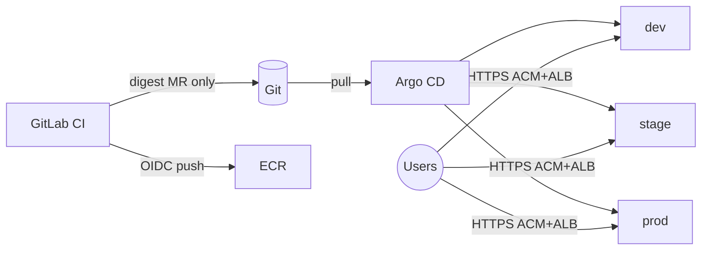
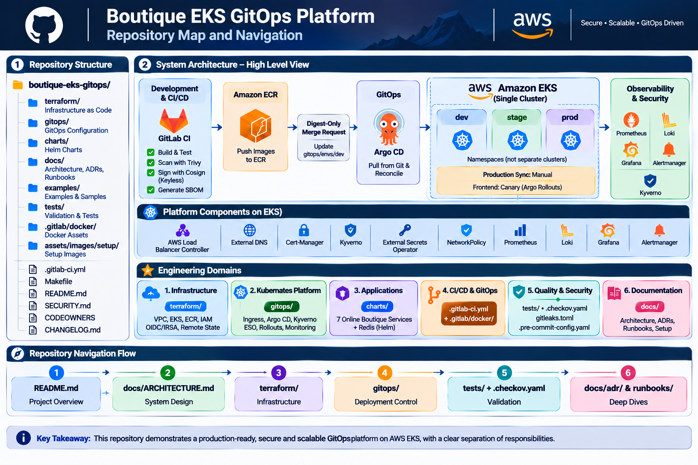

# boutique-eks-gitops

Production-pilot GitOps platform for Online Boutique on Amazon EKS — Git is the only deploy authority.

[](https://www.terraform.io/)
[](https://aws.amazon.com/eks/)
[](https://docs.gitlab.com/ee/ci/)
[](https://argo-cd.readthedocs.io/)
[](docs/ARCHITECTURE.md)
[](LICENSE)

> **Status:** Production pilot closed. Digest MR → promote → prod (manual sync and canary) ran end to end; then all AWS billable resources were destroyed. No live cluster. To run again, follow [`docs/setup/`](docs/setup/).

---

## At a glance

| | |
|-|-|
| What | Digest-only GitOps on one EKS cluster in `eu-central-1` |
| Hard rule | **CI never deploys** — GitLab CI opens digest MRs; Argo CD reconciles from Git |
| Scope | Production pilot — one account, one region; not multi-region HA |
| Stack | Terraform · EKS 1.31 · Argo CD · Rollouts · Kyverno · Prometheus / Loki / Grafana |

---

## Where to start

| I want to… | Read |
|------------|------|
| Understand the project in ~10 minutes | This page → [`docs/ARCHITECTURE.md`](docs/ARCHITECTURE.md) → [ADR-0001: digest-only GitOps](docs/adr/0001-digest-only-gitops.md) |
| Review design and delivery | [`docs/architecture/`](docs/architecture/) · [`docs/promotion.md`](docs/promotion.md) · [`docs/rollback.md`](docs/rollback.md) · [`docs/ci.md`](docs/ci.md) · [`docs/pilot-claims.md`](docs/pilot-claims.md) |
| Rebuild or operate the platform | [`docs/setup/`](docs/setup/) (topics 01–14) · [`docs/versions.md`](docs/versions.md) · [`docs/PRODUCTION_CHECKLIST.md`](docs/PRODUCTION_CHECKLIST.md) · [`docs/runbooks/`](docs/runbooks/README.md) |

Full index: [`docs/README.md`](docs/README.md)

---

## GitOps flow (summary)



Promotion: `dev → stage → prod` (digest-only MRs; **manual Argo sync for prod**). Details: [`docs/architecture/05-deployment-flow.md`](docs/architecture/05-deployment-flow.md).

---

## Repository map and navigation

Use this map for repository layout, platform components, and where each engineering area lives.



---

## What the pilot demonstrated

- Digest-only releases with promotion `dev → stage → prod` and manual prod sync
- Argo CD app-of-apps + ApplicationSet; Kyverno, External Secrets, NetworkPolicy
- GitLab CI: scan (Trivy) → sign (cosign) → digest MR only (no `kubectl` / `argocd` in CI)
- On-cluster observability (Prometheus, Loki, Grafana, Alertmanager → email) and frontend canary on stage and prod
- Ordered teardown after validation (see [`ROADMAP.md`](ROADMAP.md))

Phase 12 is an optional hardening scaffold in Git (topics 15–19) — enable after a rebuild.

---

## Technology stack

| Area | Choices |
|------|---------|
| Cloud / region | AWS `eu-central-1` |
| IaC | Terraform ≥ 1.9 |
| Kubernetes | EKS 1.31, Helm 3.16.x |
| GitOps / delivery | Argo CD, Argo Rollouts |
| Policy / secrets | Kyverno, External Secrets Operator |
| Ingress / TLS | AWS LB Controller, external-dns, ACM |
| CI / supply chain | GitLab CI, ECR, Trivy, Sigstore cosign |
| Observability | kube-prometheus-stack, Loki, Grafana |

Pins and rationale: [`docs/versions.md`](docs/versions.md) · [`docs/architecture/README.md`](docs/architecture/README.md)

---

## Repository layout

```text
boutique-eks-gitops/
├── terraform/        # VPC, EKS, ECR, IAM, remote state
├── gitops/           # Argo CD desired state (bootstrap, platform, envs)
├── charts/           # Boutique Helm charts (7 services + Redis)
├── docs/             # Architecture, setup guide, runbooks, ADRs
├── tests/            # Policy and lint fixtures
└── .gitlab-ci.yml    # Digest pipeline (dormant until CI flags are set)
```

---

## Quick clone

```bash
git clone https://github.com/btilki/boutique-eks-gitops.git
cd boutique-eks-gitops
```

Do not provision AWS from this file. Bootstrap and destroy live under [`docs/setup/`](docs/setup/).

---

## Contributing · License · References

- Contributing: [`CONTRIBUTING.md`](CONTRIBUTING.md)
- Security: [`SECURITY.md`](SECURITY.md)
- Changelog: [`CHANGELOG.md`](CHANGELOG.md)
- Roadmap: [`ROADMAP.md`](ROADMAP.md)

Licensed under Apache License 2.0 — see [`LICENSE`](LICENSE). Upstream app inspiration: [Google Online Boutique](https://github.com/GoogleCloudPlatform/microservices-demo).

Stack references: [Argo CD](https://argo-cd.readthedocs.io/) · [Argo Rollouts](https://argo-rollouts.readthedocs.io/) · [Kyverno](https://kyverno.io/) · [External Secrets](https://external-secrets.io/) · [cosign](https://docs.sigstore.dev/) · [Trivy](https://trivy.dev/) · [AWS Load Balancer Controller](https://kubernetes-sigs.github.io/aws-load-balancer-controller/)
