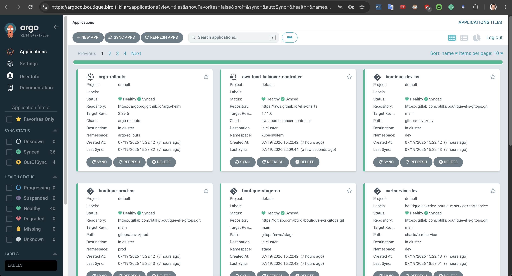
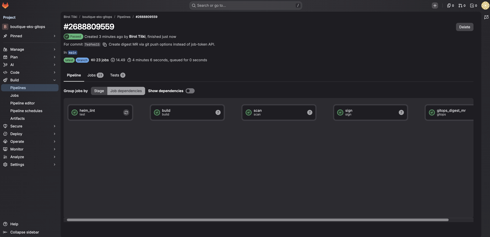
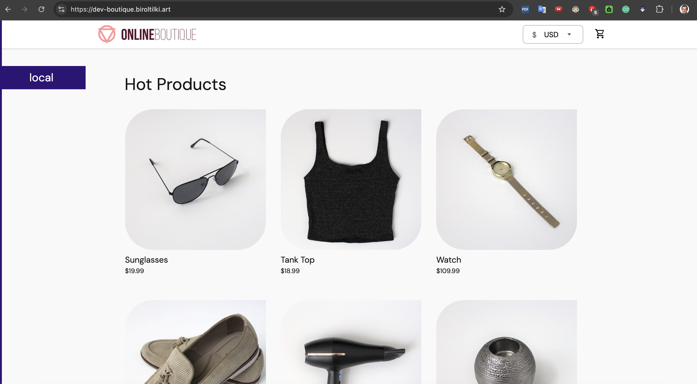
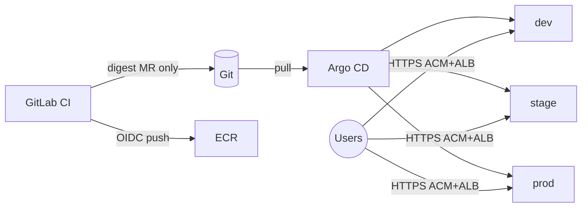
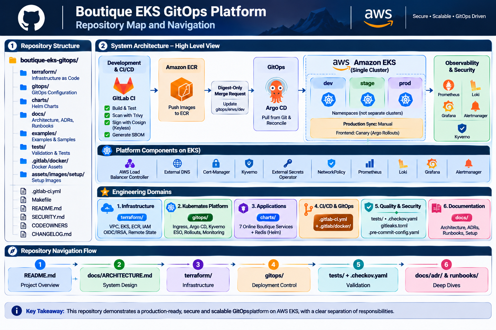

# boutique-eks-gitops

Production reference GitOps platform for Online Boutique on Amazon EKS — Git is the only deploy authority.

[](https://www.terraform.io/)
[](https://aws.amazon.com/eks/)
[](https://docs.gitlab.com/ee/ci/)
[](https://argo-cd.readthedocs.io/)
[](docs/ARCHITECTURE.md)
[](LICENSE)

> **Status:** Production reference closed (July 2026). Digest MR → promote → prod (manual sync and canary) ran end to end; then all AWS billable resources were destroyed. No live cluster.
>
> CI is dormant unless GitLab `ENABLE_REFERENCE_CI` or `ENABLE_REPO_GATES` is set ([`docs/ci.md`](docs/ci.md)). To run again, follow [`docs/setup/`](docs/setup/).

---

## Problem

Tag-based deploys and CI `kubectl`/`argocd` pushes make “what is running?” hard to audit and easy to drift. `:latest` and mutable tags break immutability; a pipeline with cluster credentials becomes a second deploy authority next to Git.

## Decision

- **Digest-only** image pins in Git; promotion is `dev → stage → prod` via MRs that change digests only ([ADR-0001](docs/adr/0001-digest-only-gitops.md)).
- **CI never deploys** — GitLab CI builds/retags, scans (Trivy), signs (cosign), and opens digest MRs; Argo CD pulls and reconciles.
- **Manual Argo sync for prod**; lower envs can auto-sync. Single EKS cluster, three namespaces (cost over blast-radius isolation).

## Result

Milestone 3 (production reference path) and Milestone 4 (clean teardown) completed. Cost stayed in the short-run band (~$35–45 with teardown vs ~$350–500/mo if left running). Screenshots from the live run are below; file-backed claims: [`docs/reference-claims.md`](docs/reference-claims.md).

---

## At a glance

| | |
|-|-|
| What | Digest-only GitOps on one EKS cluster in `eu-central-1` |
| Hard rule | **CI never deploys** — GitLab CI opens digest MRs; Argo CD reconciles from Git |
| Scope | Production reference — one account, one region; not multi-region HA |
| Stack | Terraform · EKS 1.31 · Argo CD · Rollouts · Kyverno · Prometheus / Loki / Grafana |

---

## Proof

Captures from the reference run (~2026-07-19). Full captions and gaps: [`docs/evidence/`](docs/evidence/README.md).

**Argo CD** — 40 apps Healthy on `argocd.boutique.biroltilki.art` (4 OutOfSync at capture; not named in this crop):



**GitLab CI** — pipeline `#2688809559` passed: lint → build → scan → sign → `gitops_digest_mr` (Jobs tab / MR diff not in this crop):



**Storefront** — `https://dev-boutique.biroltilki.art` over HTTPS. The purple `local` badge is the Boutique demo default when `ENV_PLATFORM` is unset — not a local Docker run:



More: stage/prod storefronts, Grafana list — [`docs/evidence/`](docs/evidence/README.md). Not in repo yet: Kyverno deny, digest MR diff, canary UI, alert email, teardown logs.

---

## Tradeoffs / what I would change for real production

- **Single cluster, three namespaces** — fine for a cost-capped reference; not true env isolation. Multi-account or separate clusters for prod.
- **Single NAT** — documented cost tradeoff; HA egress would use NAT per AZ.
- **CODEOWNERS is solo (`@btilki`)** — without GitLab “Code owner approval” enabled, the file is documentation-only, not enforced dual control ([`CODEOWNERS`](CODEOWNERS)).
- **Email-only Alertmanager** — no PagerDuty; SLOs / burn-rate alerts would come next.
- **Pins match the July 2026 evidence matrix** (EKS 1.31, Argo CD 2.14.x). A rebuild starts by bumping [`docs/versions.md`](docs/versions.md) and following [`docs/operations/13-upgrades.md`](docs/operations/13-upgrades.md).

Lessons from this reference: [`docs/lessons-learned.md`](docs/lessons-learned.md). Optional hardening ideas after a rebuild (not part of the closed reference): [`docs/setup/README.md`](docs/setup/README.md#optional-after-rebuild-phase-12-scaffolds--not-part-of-the-closed-reference).

---

## Where to start

| I want to… | Read |
|------------|------|
| Review this repo in ~10 minutes | This page → [ADR-0001](docs/adr/0001-digest-only-gitops.md) → [`docs/reference-claims.md`](docs/reference-claims.md) → [`docs/evidence/`](docs/evidence/README.md) |
| Architecture summary | [`docs/ARCHITECTURE.md`](docs/ARCHITECTURE.md) · [`docs/architecture/`](docs/architecture/) |
| Design and delivery contracts | [`docs/promotion.md`](docs/promotion.md) · [`docs/rollback.md`](docs/rollback.md) · [`docs/ci.md`](docs/ci.md) |
| Rebuild or operate | [`docs/setup/`](docs/setup/) (topics 01–14) · [`docs/versions.md`](docs/versions.md) · [`docs/PRODUCTION_CHECKLIST.md`](docs/PRODUCTION_CHECKLIST.md) · [`docs/runbooks/`](docs/runbooks/README.md) |

Full index: [`docs/README.md`](docs/README.md)

---

## GitOps flow (summary)



Promotion: `dev → stage → prod` (digest-only MRs; **manual Argo sync for prod**). Details: [`docs/architecture/05-deployment-flow.md`](docs/architecture/05-deployment-flow.md).

---

## Repository map and navigation

Use this map for repository layout, platform components, and where each engineering area lives.



---

## What the reference demonstrated

July 2026 path (Milestone 3–4): digest-only promote `dev → stage → prod`, Argo app-of-apps, Kyverno / ESO / NetworkPolicy, CI scan → sign → digest MR only, on-cluster observability + timed frontend canary, then ordered teardown. File-backed detail: [`docs/reference-claims.md`](docs/reference-claims.md). Screenshot gaps: [`docs/evidence/`](docs/evidence/README.md).

---

## Stack · layout · clone

| Area | Choices |
|------|---------|
| Cloud | AWS `eu-central-1` · Terraform ≥ 1.9 · EKS 1.31 |
| Delivery | Argo CD · Rollouts · GitLab CI · ECR · Trivy · cosign |
| Policy / edge | Kyverno · ESO · NetworkPolicy · ACM + ALB |
| Observability | Prometheus · Loki · Grafana · Alertmanager (email) |

Pins: [`docs/versions.md`](docs/versions.md). Layout: `terraform/` · `gitops/` · `charts/` · `docs/` · `tests/` · `.gitlab-ci.yml`.

```bash
git clone https://github.com/btilki/boutique-eks-gitops.git
cd boutique-eks-gitops
```

Do not provision AWS from this file — use [`docs/setup/`](docs/setup/).

[`CONTRIBUTING.md`](CONTRIBUTING.md) · [`SECURITY.md`](SECURITY.md) · [`CHANGELOG.md`](CHANGELOG.md) · [`ROADMAP.md`](ROADMAP.md) · Apache 2.0 [`LICENSE`](LICENSE) · [Online Boutique](https://github.com/GoogleCloudPlatform/microservices-demo)
