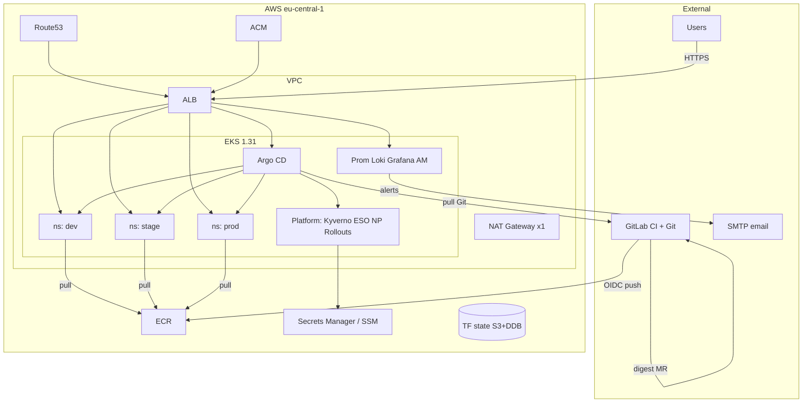

# Architecture — boutique-eks-gitops

**Status:** Accepted. Milestone 3 (production-pilot path) and Milestone 4 (clean teardown) are complete.  
Production pilot closed. The AWS stack was deleted — no live EKS, VPC, NAT, ALB, ECR, Terraform backend, Secrets Manager, ACM, or Route53 zone from the pilot.  
Maturity: production pilot — single AWS account, single EKS cluster — decommissioned  
Region: `eu-central-1` (when provisioned)

[Project README](../README.md) · [Doc index](README.md) · [Deep architecture](architecture/README.md) · [Setup](setup/README.md) · [Roadmap](../ROADMAP.md) · [Operations](operations/README.md)

---

## How to read this document

| If you want… | Stay here for… | Then open… |
|--------------|----------------|------------|
| A 10-minute picture | Executive summary and diagram | [ADR-0001](adr/0001-digest-only-gitops.md) |
| Design and delivery detail | Tradeoffs and deep-dive index | [`architecture/`](architecture/README.md) — especially [05-deployment-flow](architecture/05-deployment-flow.md), [07-security-architecture](architecture/07-security-architecture.md) |
| Evidence without a cluster | — | [`pilot-claims.md`](pilot-claims.md) |
| Rebuild | Mapping table (orientation only) | [`setup/README.md`](setup/README.md) |

This file is the architecture summary. Numbered pages under [`architecture/`](architecture/README.md) are the deep reference. Setup steps live only under [`setup/`](setup/README.md).

---

## Executive summary

This repository is the control plane for Online Boutique on Amazon EKS. **Git is the only authority** for what runs on the cluster. GitLab CI publishes an image (default: retag ECR `:bootstrap`; optional: build from the Boutique Git tag), scans (Trivy), signs (cosign), and opens MRs that change only image digests. Argo CD reconciles desired state; **CI never deploys**.

`dev`, `stage`, and `prod` are namespaces on one cluster (cost over blast-radius isolation). Boundaries: NetworkPolicy, sync policy (**manual prod sync**), and CODEOWNERS on prod paths. Public HTTPS uses ACM on ALB. Observability is on-cluster: Prometheus, Loki, Grafana, Alertmanager → email. After validation, this pilot was torn down — see [teardown runbook](runbooks/teardown.md) and checklist Appendix T in [`PRODUCTION_CHECKLIST.md`](PRODUCTION_CHECKLIST.md).

File-backed claims (no cluster required): [`pilot-claims.md`](pilot-claims.md).

---

## Requirements (condensed)

| ID | Requirement | Implication |
|----|-------------|-------------|
| FR-01 | Terraform foundation | Modular VPC / EKS / ECR / IAM / OIDC + remote state |
| FR-02 | Ingress / DNS / TLS | LB Controller + external-dns + ACM; cert-manager present |
| FR-03 | Argo GitOps | App-of-apps + ApplicationSet; prod manual sync |
| FR-04 | Security baseline | Kyverno digest / ECR; ESO; NetworkPolicy |
| FR-05 | Observability | Prometheus / Loki / Grafana / Alertmanager → email — no CloudWatch / PagerDuty / OTel |
| FR-06–09 | Boutique + CI + promote + canary | Seven services; digest MRs; stage + prod canary |
| FR-10–11 | Checklist + teardown | Production-pilot checklist; ordered destroy |

Full tables: [01-requirements.md](architecture/01-requirements.md)

Constraints (short): AWS-only; one cluster; digest-only; **CI never deploys**; `@btilki` on prod paths; no static AWS keys in Git.  
Assumptions (short): Route53 zone `biroltilki.art`; GitLab OIDC; SMTP for Alertmanager tests.  
Details: [01-requirements.md](architecture/01-requirements.md)

---

## High-level architecture

**Layers**

| Layer | Responsibility |
|-------|----------------|
| Infrastructure | VPC, single NAT, EKS, ECR, IAM / OIDC / IRSA, ACM, Route53, remote state |
| Platform | Ingress, Argo CD, Kyverno, ESO, NetworkPolicy, Rollouts, monitoring |
| Applications | Seven Boutique services + Redis; digest-pinned Helm per env |
| CI/CD | GitLab: test → build → scan → sign → digest MR only |
| Observability | Prometheus, Loki, Grafana, Alertmanager (email) |

Context and components: [02-system-context.md](architecture/02-system-context.md), [03-component-design.md](architecture/03-component-design.md)

---

## Deep-dive index

| Topic | Document |
|-------|----------|
| Data / secrets / Terraform flows | [04-data-flows.md](architecture/04-data-flows.md) |
| Deploy, promote, rollback, sync waves | [05-deployment-flow.md](architecture/05-deployment-flow.md) |
| VPC, ingress, DNS, NetworkPolicy | [06-network-design.md](architecture/06-network-design.md) |
| Trust zones, IRSA, supply chain | [07-security-architecture.md](architecture/07-security-architecture.md) |
| Failure, scale, DR, rebuild | [08-resilience-and-dr.md](architecture/08-resilience-and-dr.md) |
| Metrics, logs, alerts | [09-observability.md](architecture/09-observability.md) |
| Cost and teardown economics | [10-cost-model.md](architecture/10-cost-model.md) |
| Design decisions | [ADR index](architecture/README.md#architecture-decision-records) |

Resilience (summary): multi-AZ nodes; single NAT (cost tradeoff). DR = rebuild from Git + Terraform, not multi-region failover.  
Cost (summary): ~$350–500/mo if left running; ~$30–45 for a short pilot with teardown — see [10-cost-model.md](architecture/10-cost-model.md).

---

## Key tradeoffs

| Decision | Chosen | Rejected | Why |
|----------|--------|----------|-----|
| Deploy authority | GitOps pull (Argo) | CI `kubectl` push | Audit + drift control |
| Env isolation | Namespaces | Three clusters | Cost |
| TLS | ACM + ALB | cert-manager as primary public TLS | Fewer moving parts |
| Observability | Prometheus / Loki / Alertmanager on cluster | CloudWatch / PagerDuty / OTel | Cost + simplicity |
| Images | Digest-only | Tags / `:latest` | Immutability |

Recorded decisions: [ADR-0001](adr/0001-digest-only-gitops.md) through [ADR-0010](adr/0010-edge-waf-and-falco.md) — index in [architecture/README.md](architecture/README.md).

Out of scope for this pilot: service mesh, multi-region, CloudWatch / PagerDuty / OTel as primary paths.

---

## Hostnames (locked)

`argocd.boutique.biroltilki.art` · `grafana.boutique.biroltilki.art` · `dev-boutique` / `stage-boutique` / `boutique.biroltilki.art` — detail: [dns-and-tls.md](dns-and-tls.md) · [ADR-0004](adr/0004-dns-hostname-scheme.md)

---

## Component → repo → setup topic

Orientation only — steps live in [`setup/`](setup/README.md).

| Component | Repo path | Setup topic |
|-----------|-----------|-------------|
| Versions / ADRs | `docs/versions.md`, `docs/adr/` | 01, 02 |
| Remote state | `terraform/envs/prod/backend*` | 03 |
| VPC / EKS / ECR / OIDC | `terraform/modules/*` | 04 |
| Ingress / DNS / TLS | `gitops/platform/{aws-load-balancer-controller,external-dns,cert-manager}/` | 05 |
| Argo CD | `gitops/bootstrap/`, `gitops/apps/` | 06 |
| Kyverno / ESO / NP | `gitops/platform/{kyverno,external-secrets,network-policies}/` | 07 |
| Observability | `gitops/platform/monitoring/` | 08 |
| Boutique | `charts/`, `gitops/envs/` | 09 |
| GitLab CI | `.gitlab-ci.yml` | 10 |
| Promotion / canary | `docs/promotion.md`, `gitops/platform/argo-rollouts/` | 11, 12 |
| Production-pilot checklist | `docs/PRODUCTION_CHECKLIST.md` | 13 |
| Teardown | `docs/runbooks/teardown.md` | 14 |
