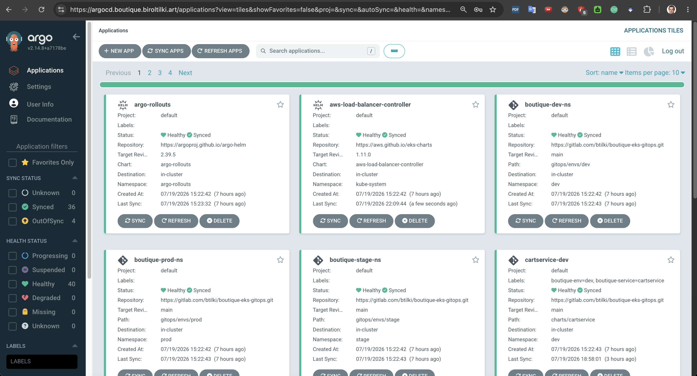
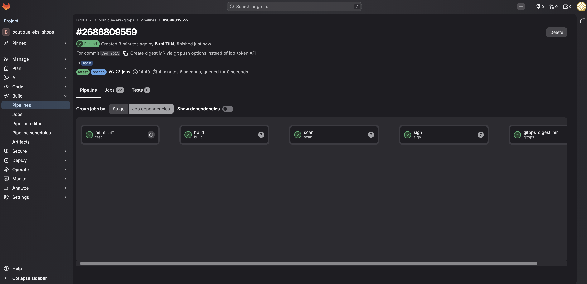
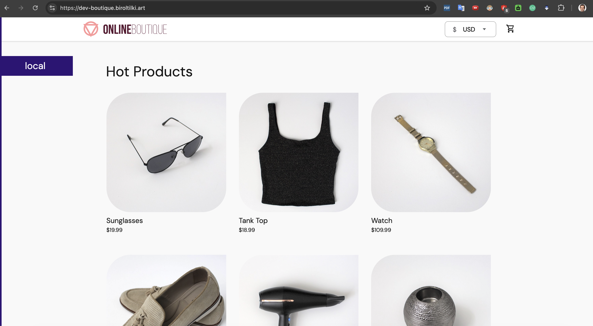
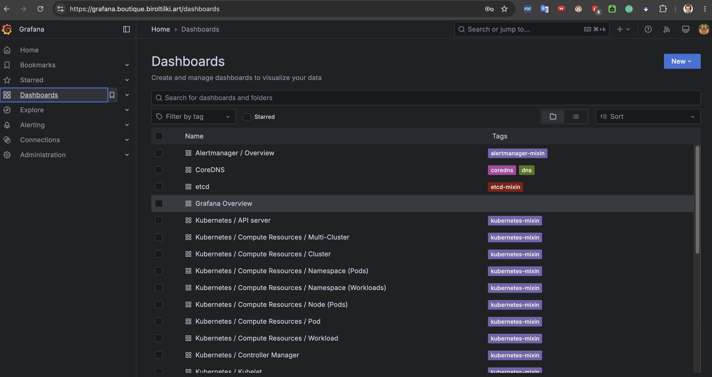

# Pilot evidence — boutique-eks-gitops

Screenshots from the live production pilot (~2026-07-19). The cluster and other AWS billables were destroyed afterward (Milestone 4). There is no live demo today — these images are the file-backed proof that the path ran.

Assets live under [`assets/images/setup/`](../../assets/images/setup/). Landing-page crop: [project README — Proof](../../README.md#proof).

---

## Captured

### Argo CD — applications dashboard

`argocd.boutique.biroltilki.art` · Argo CD v2.14.8 · 40 apps Healthy · 36 Synced · 4 OutOfSync at capture. Namespace apps for `dev` / `stage` / `prod` and platform charts are visible. The four OutOfSync apps were not named in this crop — treat them as unexplained at screenshot time unless a later capture labels them (for example pending prod manual sync).

File: [`06-argocd-applications-dashboard.png`](../../assets/images/setup/06-argocd-applications-dashboard.png)

### GitLab CI — digest pipeline passed

Pipeline `#2688809559` passed (~4m). Stage cards show `helm_lint` → `build` → `scan` → `sign` → `gitops_digest_mr`. This crop does not show the Jobs list, SBOM job output, or the digest MR diff.

File: [`10-gitlab-ci-pipeline-passed.png`](../../assets/images/setup/10-gitlab-ci-pipeline-passed.png)

### Boutique — HTTPS storefronts

`https://dev-boutique.biroltilki.art` over HTTPS (ACM + ALB). The purple `local` badge is the Online Boutique demo default when `ENV_PLATFORM` is unset — it does not mean a local Docker run. Stage and prod captures use the same demo UI with different hostnames.

| Env | File | Host |
|-----|------|------|
| Dev | [`09-boutique-dev-homepage.png`](../../assets/images/setup/09-boutique-dev-homepage.png) | `dev-boutique.biroltilki.art` |
| Stage | [`11-boutique-stage-homepage.png`](../../assets/images/setup/11-boutique-stage-homepage.png) | `stage-boutique.biroltilki.art` |
| Prod | [`13-boutique-prod-homepage.png`](../../assets/images/setup/13-boutique-prod-homepage.png) | `boutique.biroltilki.art` |

### Grafana — dashboard list

`grafana.boutique.biroltilki.art` — stock kube-prometheus-stack dashboard list. Proves Grafana was reachable on the pilot hostname; it does not show Boutique-specific panels, Loki queries, or a firing alert.

File: [`08-grafana-dashboards.png`](../../assets/images/setup/08-grafana-dashboards.png)

---

## Not shown yet

These claims are in the docs / checklist but do not have screenshots in this folder. Add them on a rebuild (or if you still have private captures):

| Gap | Why it matters |
|-----|----------------|
| Digest MR diff (`image.digest` only) | Proves CI never wrote deploy commands — only Git |
| Full pipeline Jobs tab (incl. SBOM / policy jobs if enabled) | Completes the stage-card crop |
| Kyverno deny (`:latest` or non-ECR image) | Admission proof |
| Argo Rollouts canary progress (stage/prod) | Progressive delivery proof |
| Prod OutOfSync → manual Sync | Manual prod sync story |
| cosign verify / SBOM attestation / ECR scan | Supply-chain depth |
| AWS console: EKS + nodes across AZs | Multi-AZ foundation |
| Alertmanager email | Observability path end-to-end |
| Teardown: `terraform destroy` / orphan audit | Milestone 4 proof |

Related file-backed claims (no cluster required): [`../pilot-claims.md`](../pilot-claims.md) · checklist: [`../PRODUCTION_CHECKLIST.md`](../PRODUCTION_CHECKLIST.md)

---

## Related

- Lessons from the pilot: [`../lessons-learned.md`](../lessons-learned.md)
- Version pins used for this evidence: [`../versions.md`](../versions.md)
- Rebuild: [`../setup/README.md`](../setup/README.md)
